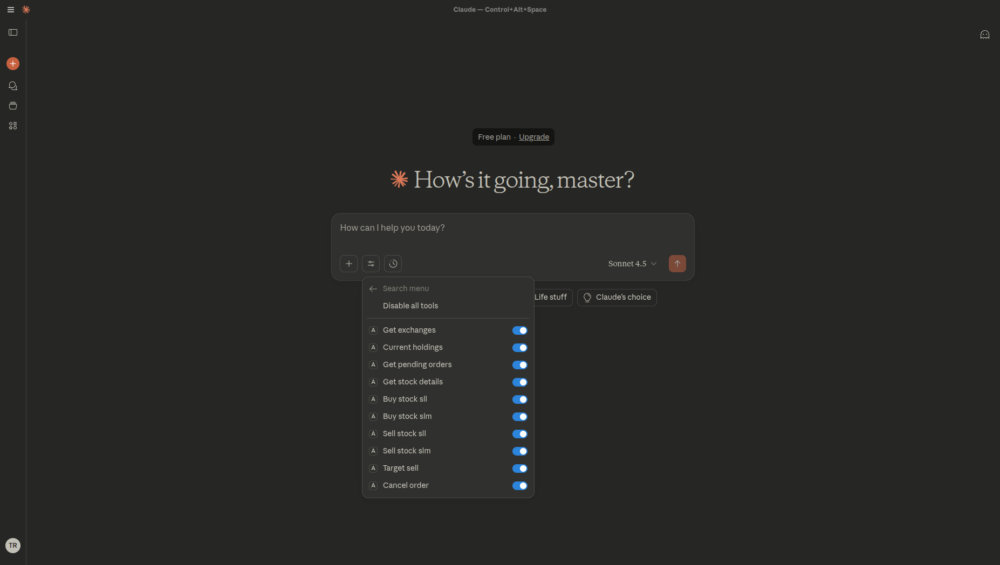

# Angel One MCP Server

A Model Context Protocol (MCP) server for interacting with Angel One (Angel Broking) trading platform. This server enables AI assistants like Claude to access your Angel One account and generate trading intents — but it now implements a secure, human-in-the-loop approval flow so that no trade executes directly from an assistant tool call.

## Features

- **Portfolio Management**: View current holdings and portfolio summary

- **Order Management (Intent Model)**: Create trade intents (buy/sell/target/cancel) which require an explicit, human-approved second step to execute

- **Order Tracking**: View and cancel pending orders (cancel creates an intent and requires approval)

- **Historical Data**: Fetch OHLCV data for stocks

- **Smart Symbol Resolution**: Suggests candidate symbols for ambiguous names; requires explicit symbol selection for execution

## Prerequisites

- Python 3.12 or higher

- Angel One trading account with API access

- Angel One API credentials (API key, username, password, TOTP token)

## Installation

### Option 1: Using uv (Recommended)

[uv](https://github.com/astral-sh/uv) is a fast Python package installer and resolver.

1. **Install uv**: Follow the installation instructions at https://docs.astral.sh/uv/getting-started/installation/

2. **Clone and setup the project**:

   ```bash

   git clone https://github.com/pdthekd/angelone-mcp.git

   cd angelone-mcp

   uv sync

   ```

3. **Download latest market mappings**:

   ```bash

   uv run python scripts/downloadLatestMappings.py

   ```

### Option 2: Using pip

1. **Clone the repository**:

   ```bash

   git clone https://github.com/pdthekd/angelone-mcp.git

   cd angelone-mcp

   ```

2. **Create a virtual environment**:

   ```bash

   python -m venv .venv

   # Activate it

   # On macOS/Linux:

   source .venv/bin/activate

   # On Windows:

   .venv\Scripts\activate

   ```

3. **Install dependencies**:

   ```bash

   pip install -e .

   ```

4. **Download latest market mappings**:

   ```bash

   python scripts/downloadLatestMappings.py

   ```

> Note: The mapping downloader now enforces a domain allowlist and TLS verification. If you run it behind strict proxies, allow connections to:

> - margincalculator.angelbroking.com

> - nsearchives.nseindia.com

## Configuration

1. **Create a `.env` file** in the project root:

   ```bash

   cp .env.example .env

   ```

2. **Fill in your Angel One credentials**:

   ```env

   api_key = "your_api_key"

   username = "your_client_id"

   pwd = "your_password"

   token = "your_totp_token"

   threshold = "80"

   ```

**Configuration Parameters:**

- `api_key`: Your Angel One API key

- `username`: Your Angel One client ID

- `pwd`: Your Angel One password

- `token`: Your TOTP token from Angel One mobile app

- `threshold`: Fuzzy matching threshold for company name resolution (0-100)

## Running the Server

### Standalone Mode

```bash

# Using uv

uv run angelone-mcp

# Using pip (with venv activated)

angelone-mcp

```

### With Claude Desktop

1. **Locate your Claude Desktop config file**:

   - **macOS**: `~/Library/Application Support/Claude/claude_desktop_config.json`

   - **Windows**: `%APPDATA%\Claude\claude_desktop_config.json`

2. **Add the MCP server configuration**:

   **If using uv**:

   ```json

   {

     "mcpServers": {

       "angelone": {

         "command": "uv",

         "args": [

           "--directory",

           "/absolute/path/to/angelone-mcp",

           "run",

           "angelone-mcp"

         ]

       }

     }

   }

   ```

   **If using pip**:

   ```json

   {

     "mcpServers": {

       "angelone": {

         "command": "/absolute/path/to/angelone-mcp/.venv/bin/angelone-mcp",

         "args": []

       }

     }

   }

   ```

3. **Restart Claude Desktop**



## Available Tools

The MCP server provides the following tools to Claude. IMPORTANT: buy/sell/target/cancel tools now create "trade intents" only and do NOT place orders immediately. Each intent returns a request ID that a human must approve by calling `approve_trade`.

| Tool | Description |

|------|-------------|

| `get_exchanges` | Get list of available exchanges (NSE, BSE) |

| `current_holdings` | View your current stock holdings and portfolio summary |
| `get_positions` | Open intraday/F&O positions (read-only) |
| `get_rms_limit` | Funds and margin: cash, collateral, utilised (read-only) |
| `get_market_quote` | Quotes for up to 50 symbols, mode LTP/OHLC/FULL (read-only) |
| `search_scrip` | Find symbols and tokens by text (read-only) |
| `estimate_charges` | Brokerage and tax estimate for hypothetical orders; places nothing |

| `get_pending_orders` | View all pending orders (orders already acknowledged by broker) |

| `get_stock_details` | Fetch historical OHLCV data for a stock |

| `buy_stock_sll` | Create a Stop Loss Limit buy order intent (returns request_id). Does NOT execute. |

| `buy_stock_slm` | Create a Stop Loss Market buy order intent (returns request_id). Does NOT execute. |

| `sell_stock_sll` | Create a Stop Loss Limit sell order intent (returns request_id). Does NOT execute. |

| `sell_stock_slm` | Create a Stop Loss Market sell order intent (returns request_id). Does NOT execute. |

| `target_sell` | Create a Target Sell order intent (returns request_id). Does NOT execute. |

| `modify_order` | Create a Modify order intent (qty/price/trigger of an open order). Does NOT execute. |

| `cancel_order` | Create a Cancel order intent (returns request_id). Does NOT execute. |

| `approve_trade` | Execute an intent a human already approved via the PIN dialog (`request_id`, `operator`). |

Important: `approve_trade` only runs intents a human already approved through the local PIN dialog (see Security Notes).

## Usage Examples

- Create a trade intent:

  - Assistant: "Create an SL-L Buy intent for 10 shares of SBIN-EQ at trigger 500 and limit 505"

  - Tool call: `buy_stock_sll(...)` -> Returns: "⚠️ TRADE INTENT CREATED. ID: abc12345. To execute, you MUST call the `approve_trade` tool."

- Execute a created intent (HUMAN ONLY):

  - Operator: call `approve_trade` after verifying the details in the intent and checking your holdings/TOTP.

- Preview-only mode:

  - You can use the assistant to create intents and inspect the details without ever calling `approve_trade` — this is the recommended demo mode.

## Operator Authentication (approve_trade)

Approval flow:

1. Intent tools return a `request_id` and execute nothing.
2. `request_trade_approval` / `request_batch_trade_approval` open a PIN dialog on your own desktop. The PIN is checked inside the server and never passes through the chat.
3. `approve_trade(request_id, operator)` runs the intent. Each intent runs at most once, and only within `APPROVAL_TTL_SECONDS` of the PIN approval.

Env vars: `HUMAN_APPROVAL_PIN` (required), `ALLOWED_OPERATORS` (optional, comma-separated), `APPROVAL_TTL_SECONDS` (optional, default 900).

## Security Notes

⚠️ IMPORTANT — READ CAREFULLY

- Trade safety model changed: This version implements a two-step intent/approval workflow. All "write" operations (buy/sell/target/cancel) create pending intents; they do not execute trades until a human approves them in the local PIN dialog and `approve_trade(request_id, operator)` is called.

- Never commit your `.env` file to version control.

- Keep your API credentials secure and rotate them if accidentally exposed.

- The mapping downloader enforces TLS verification and a domain allowlist to reduce remote-code/data-supply risk.

- Keep `HUMAN_APPROVAL_PIN` only in `.env`; never type it into the chat.

- Before enabling live trades, set `HUMAN_APPROVAL_PIN` and test with a tiny order.

## Troubleshooting

### Common Issues

1. **Symbol not found**: The server uses fuzzy matching to resolve company names. If the top fuzzy match is ambiguous you will be asked to provide the exact trading symbol (e.g., "SBIN-EQ"). Use the exact symbol to create the intent.

2. **Session expired**: The server automatically manages sessions, but if you encounter authentication errors, restart the server.

3. **Missing mappings**: Run the `downloadLatestMappings.py` script to refresh market data:

   ```bash

   uv run python scripts/downloadLatestMappings.py

   # or with pip

   python scripts/downloadLatestMappings.py

   ```

4. **Claude Desktop not detecting server**:

   - Verify the absolute path in your config file

   - Check that the server runs in standalone mode first

   - Restart Claude Desktop completely

5. **Import errors**: Make sure you've installed the package with `pip install -e .` or `uv sync`

## Contributing

Contributions are welcome! Please feel free to submit a Pull Request.

1. Fork the repository

2. Create your feature branch (`git checkout -b feature/AmazingFeature`)

3. Commit your changes (`git commit -m 'Add some AmazingFeature'`)

4. Push to the branch (`git push origin feature/AmazingFeature`)

5. Open a Pull Request

## License

MIT License - see [LICENSE](LICENSE) file for details

## Disclaimer

⚠️ **IMPORTANT DISCLAIMER**

This software is provided for educational and informational purposes only. Trading in financial markets involves substantial risk of loss and is not suitable for every investor.


